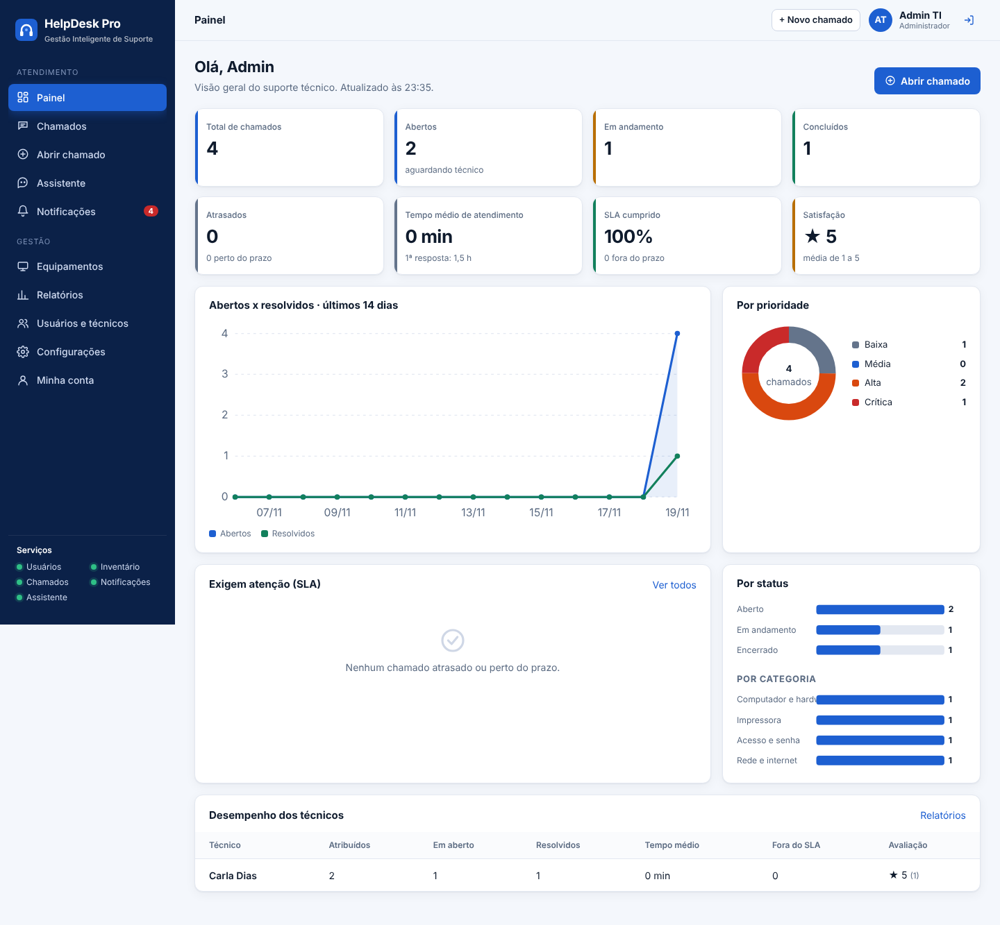
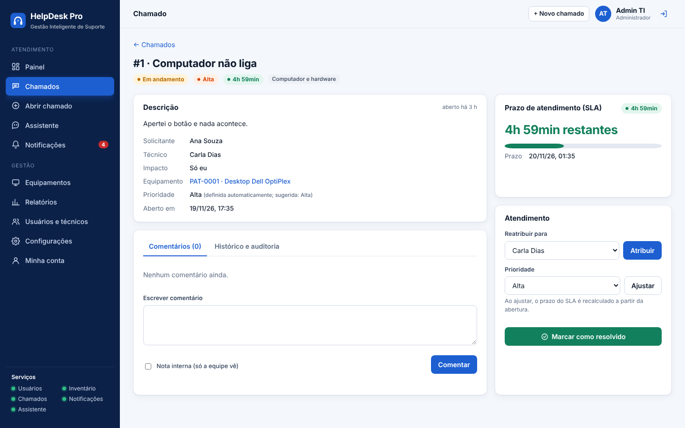
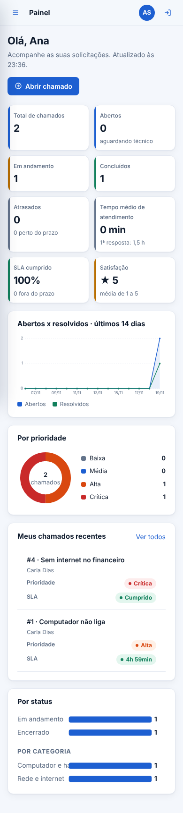
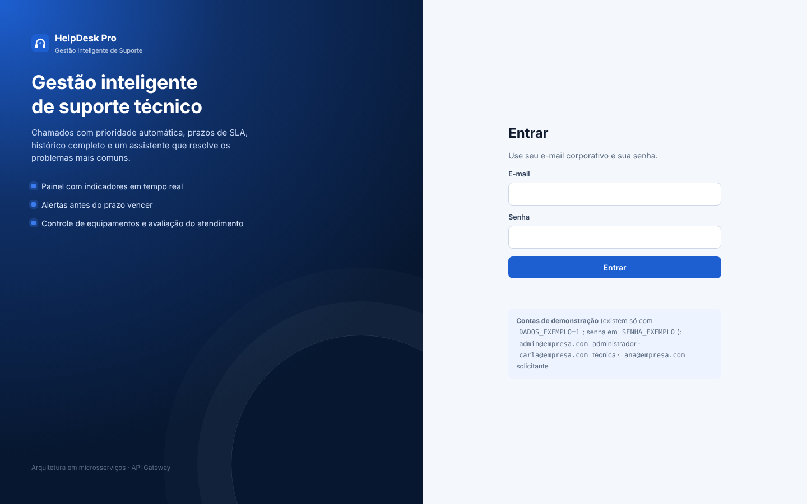
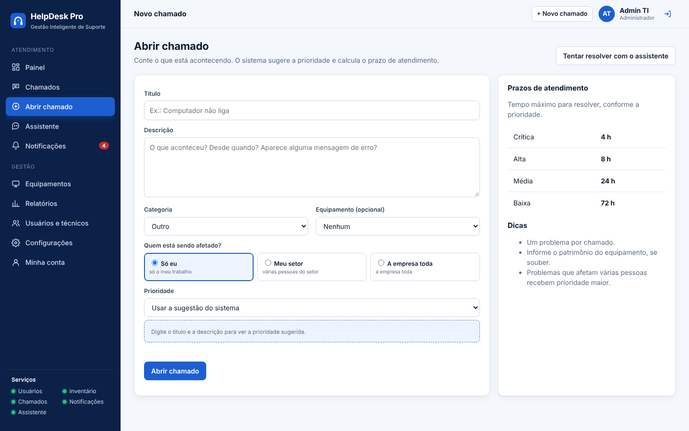
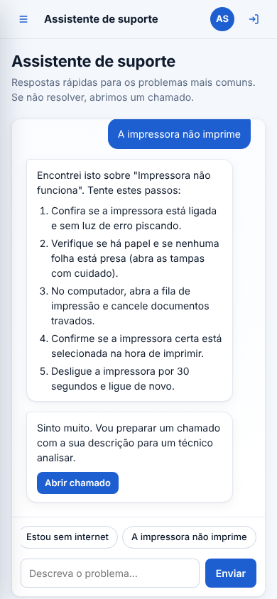
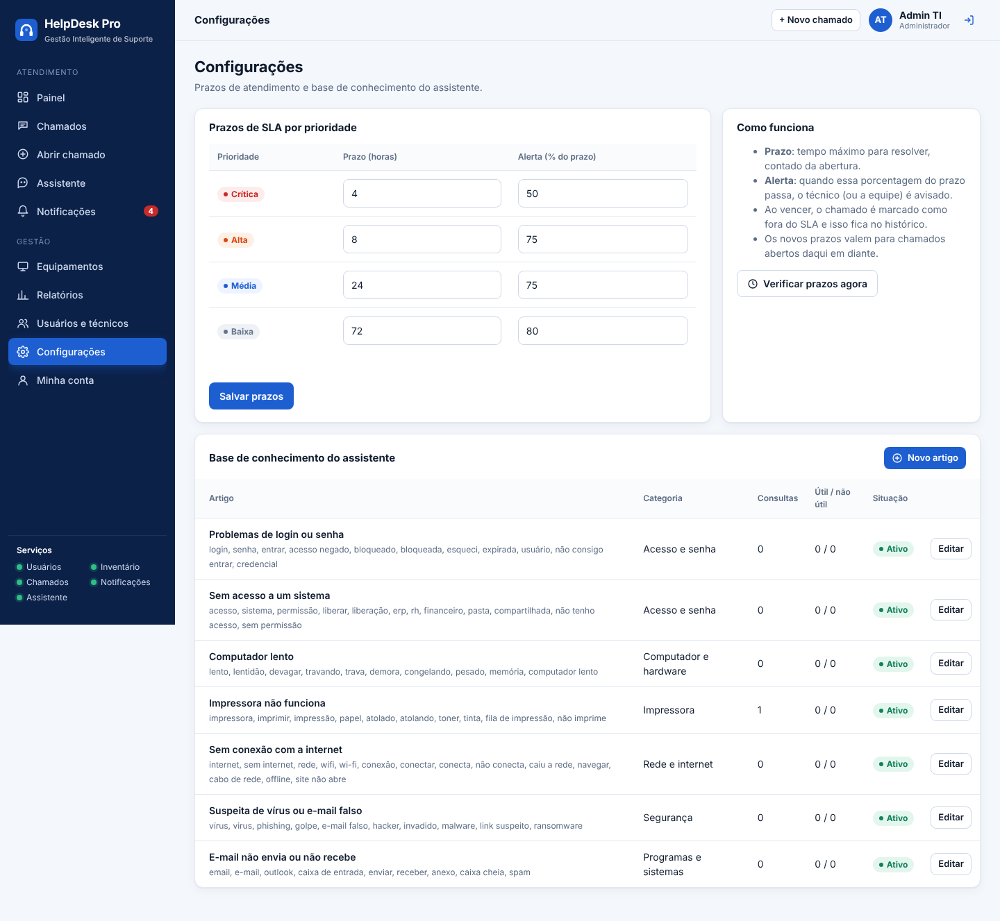
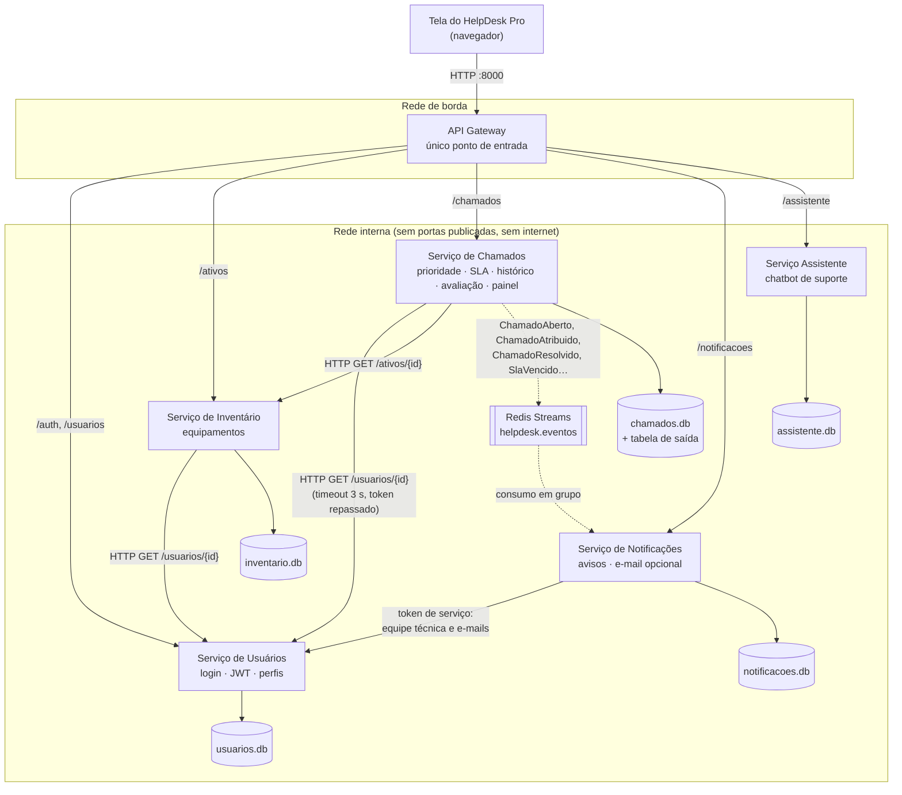

# HelpDesk Pro · Gestão Inteligente de Suporte Técnico

> ## 🎬 Vídeo de apresentação
> **Link:** _cole aqui o link do vídeo (YouTube não listado ou Google Drive com acesso por link)_

Plataforma de gerenciamento de suporte técnico construída a partir do **HelpDesk TI** (monólito da disciplina de
Arquitetura de Software). O sistema foi **separado em microsserviços** — exigência do [DESAFIO.md](DESAFIO.md) — e
ganhou priorização automática, SLA configurável, auditoria, notificações por evento, avaliação do atendimento,
controle de equipamentos, chatbot de suporte e uma interface nova, responsiva.

| Painel do administrador | Detalhe do chamado | Celular |
|---|---|---|
|  |  |  |

| Login | Abrir chamado (prioridade sugerida) | Assistente | Configurações |
|---|---|---|---|
|  |  |  |  |

---

## Sumário

1. [Objetivo](#objetivo)
2. [Tecnologias](#tecnologias)
3. [Arquitetura](#arquitetura)
4. [Funcionalidades](#funcionalidades)
5. [Perfis e permissões](#perfis-e-permissões)
6. [Como executar](#como-executar)
7. [Banco de dados](#banco-de-dados)
8. [Variáveis de ambiente](#variáveis-de-ambiente)
9. [Testes](#testes)
10. [Estrutura de pastas](#estrutura-de-pastas)
11. [Rotas da API](#rotas-da-api)
12. [Decisões de arquitetura](#decisões-de-arquitetura)
13. [Melhorias em relação ao projeto original](#melhorias-em-relação-ao-projeto-original)
14. [Roteiro sugerido para o vídeo](#roteiro-sugerido-para-o-vídeo)

## Objetivo

Centralizar o atendimento de TI de uma empresa: o usuário abre o chamado (ou resolve sozinho com o assistente), o
sistema sugere a prioridade e calcula o prazo, o técnico atende com histórico completo e o gestor acompanha
indicadores de desempenho, prazos e satisfação. Cada parte do sistema pertence a um serviço independente, que
pode ser publicado, escalado e mantido por um time diferente.

## Tecnologias

As tecnologias do projeto original foram mantidas; as adições têm justificativa na seção de decisões.

| Camada | Tecnologia |
|---|---|
| Serviços e gateway | Python 3.12, **FastAPI**, Uvicorn |
| Banco (um por serviço) | **SQLite** com **SQLAlchemy 2** (cada serviço no seu volume) |
| Validação | Pydantic 2 (entrada estrita: campos extras recusados) |
| Autenticação | JWT (PyJWT, HS256) e senhas com **scrypt** |
| Comunicação síncrona | HTTP com **httpx** (timeout e repasse do token) |
| Fila de eventos | **Redis Streams** com grupo de consumo (adição) |
| Tela | HTML, CSS e JavaScript puros (módulos ES), gráficos em SVG próprio — sem CDN |
| Infraestrutura | Docker, Docker Compose, GitHub Actions, Dependabot, pip-audit |

## Arquitetura



**Como os serviços conversam**

- **Síncrono (HTTP):** Chamados confere o técnico em Usuários e o equipamento em Inventário; Inventário confere o
  responsável em Usuários. Toda chamada tem **timeout** e **repassa o token** do usuário e o `X-Request-ID`.
  Se o outro serviço não responder, a operação devolve **503 com mensagem clara** e nada trava.
- **Assíncrono (eventos):** cada mudança de chamado grava um evento na **tabela de saída** (padrão *Outbox*) na
  mesma transação. Uma tarefa publica no Redis Stream; o serviço de Notificações consome com **grupo de consumo**
  (continua de onde parou se cair) e é **idempotente** (o mesmo evento nunca gera aviso duplicado).
- **Cópia local dos nomes:** chamados e equipamentos guardam o id **e o nome** do usuário/equipamento no momento
  da operação. Assim as telas continuam funcionando mesmo com Usuários fora do ar.

**Camadas dentro de cada serviço**

```
rotas.py        → HTTP: valida entrada (Pydantic), exige login/perfil, chama o serviço
servico.py      → regras de negócio (sem saber nada de HTTP)
repositorio.py  → consultas ao banco (SQLAlchemy)
modelos.py      → tabelas  ·  esquemas.py → contratos de entrada/saída  ·  clientes.py → outros serviços
banco.py        → conexão exclusiva do serviço + migrações
```

A biblioteca `comum/helpdesk_comum` reúne só infraestrutura igual para todos (conferência do JWT, tratamento
centralizado de erros, cabeçalhos de segurança, logs em JSON, cliente HTTP com timeout, migrações). **Nenhuma regra
de negócio fica nela**, e cada serviço continua sendo um projeto próprio com Dockerfile, dependências e testes.

## Funcionalidades

### Exigidas pelo DESAFIO (mantidas do monólito)
Abrir, atribuir, mudar status (com as mesmas transições), comentar e ver o painel; SLA por prioridade; login e
permissões por perfil; notificações de abertura, atribuição e resolução.

### Novas no HelpDesk Pro

| Módulo | O que faz |
|---|---|
| **Painel inteligente** | Total, abertos, em andamento, concluídos, atrasados, tempo médio de atendimento e de 1ª resposta, % de SLA cumprido, satisfação média, gráfico de abertos × resolvidos (14 dias), distribuição por prioridade, status e categoria, desempenho por técnico e lista de chamados que exigem atenção. Atualiza a cada minuto. |
| **Priorização automática** | Regras de pontuação explicáveis (impacto, palavras-chave como "fora do ar", "vírus", "não liga", categoria e tipo de equipamento) sugerem baixa/média/alta/crítica **enquanto o usuário digita**, mostrando os motivos. Técnicos e administradores ajustam a prioridade com motivo registrado; o prazo é recalculado. |
| **SLA** | Prazos e limiar de alerta por prioridade **configuráveis pelo administrador**; contagem regressiva e barra de progresso em cada chamado; verificação automática a cada minuto que avisa antes de vencer e **registra a violação** (data, histórico e evento). |
| **Histórico e auditoria** | Toda ação vira uma linha imutável: quem abriu, atribuições, mudanças de status e prioridade (valor anterior → novo), solução, comentários, alertas do SLA, encerramento e avaliação. Tela própria no detalhe do chamado. |
| **Notificações** | Abertura (solicitante e equipe), atribuição (técnico e solicitante), mudança de status, mudança de prioridade, SLA perto de vencer, SLA vencido, resolução e encerramento. Contador no menu, marcar como lida e canal de e-mail SMTP preparado (liga com `SMTP_HOST`). |
| **Avaliação** | Após o encerramento, o solicitante dá de 1 a 5 estrelas e um comentário (uma vez). Média por técnico e relatório de satisfação com distribuição das notas e comentários recentes. |
| **Equipamentos** | Computadores, notebooks, impressoras, monitores, periféricos, rede e outros; marca, modelo, série, setor, situação (em uso, estoque, manutenção, descartado) e **responsável** (validado no serviço de Usuários). Cada chamado pode ser vinculado a um equipamento e cada equipamento mostra os seus chamados. |
| **Assistente (chatbot)** | Base de perguntas e respostas própria, sem IA paga: internet, impressora, computador lento, login/senha, acesso a sistemas, e-mail e suspeita de vírus. Pergunta "resolveu?"; se não, abre o chamado já preenchido. O admin edita a base e vê as perguntas sem resposta. |
| **Gestão** | Administrador cadastra e edita usuários e técnicos, desativa acessos (o usuário perde o acesso na hora), redefine senhas; usuário troca a própria senha; notas internas só para a equipe; exportação CSV protegida contra injeção de fórmulas. |
| **Saúde do sistema** | `GET /saude` no gateway mostra o estado de cada serviço; a tela exibe isso no rodapé do menu (verde/vermelho). |

## Perfis e permissões

| Ação | Usuário (solicitante) | Técnico | Administrador |
|---|:-:|:-:|:-:|
| Abrir chamado e usar o assistente | ✅ | ✅ | ✅ |
| Ver chamados e histórico | só os seus | todos | todos |
| Comentar | nos seus | todos (+ notas internas) | todos (+ notas internas) |
| Atribuir, ajustar prioridade, resolver (com solução) | ❌ | ✅ | ✅ |
| Encerrar ou reabrir chamado resolvido | os seus | ✅ | ✅ |
| Avaliar atendimento | os seus, após encerrar | ❌ | ❌ |
| Painel | dos seus chamados | geral + "meus indicadores" | geral + todos os técnicos |
| Relatórios de satisfação | ❌ | os seus | todos + CSV + assistente |
| Cadastrar/editar equipamentos | ❌ (vê os seus) | ✅ | ✅ |
| Gerenciar usuários e técnicos, configurar SLA e base do assistente | ❌ | ❌ | ✅ |

As permissões são conferidas **no backend de cada serviço**; a tela apenas esconde o que o perfil não pode usar.

## Como executar

### Com Docker (recomendado)

```bash
docker compose up --build
```

Pronto: não é preciso criar `.env` nem ajustar nada. Abra **http://localhost:8000**.

```bash
docker compose ps                  # todos os contêineres e o estado de saúde
docker compose stop inventario     # derruba um serviço (o resto continua; abrir chamado com equipamento dá 503)
docker compose start inventario
docker compose logs -f chamados    # logs em JSON, com o X-Request-ID de cada requisição
docker compose down                # para tudo (os volumes com os bancos continuam)
docker compose down -v             # para tudo e apaga os bancos
```

### Sem Docker (desenvolvimento)

Python 3.11+ (e, opcionalmente, `redis-server` para as notificações por evento):

```bash
pip install -r requirements-dev.txt
./scripts/rodar_local.sh           # sobe Redis, os 5 serviços e o gateway; Ctrl+C para parar
```

### Contas de demonstração

Criadas só com `DADOS_EXEMPLO=1` (padrão) e banco vazio. Senha de todas: **`Helpdesk2026`** (`SENHA_EXEMPLO`).

| E-mail | Perfil |
|---|---|
| `admin@empresa.com` | Administrador |
| `carla@empresa.com` · `diego@empresa.com` | Técnicos |
| `ana@empresa.com` · `bruno@empresa.com` | Usuários (solicitantes) |

> Os dados de exemplo (usuários, 5 equipamentos e 3 chamados) existem apenas para a aula e são identificados como
> tal na tela de login. Em produção use `DADOS_EXEMPLO=0` e crie o primeiro administrador com `ADMIN_EMAIL` e
> `ADMIN_SENHA`.

A documentação Swagger de cada serviço fica interna à rede do Docker (só o gateway é exposto). Para vê-la em
desenvolvimento, rode sem Docker e acesse, por exemplo, http://localhost:8003/docs.

## Banco de dados

**Um banco por serviço**, cada um num volume próprio; nenhum serviço lê o banco de outro e **não há chaves
estrangeiras entre serviços** (só ids).

| Serviço | Volume | Tabelas |
|---|---|---|
| Usuários | `banco-usuarios` | `usuarios` |
| Inventário | `banco-inventario` | `ativos` |
| Chamados | `banco-chamados` | `chamados`, `comentarios`, `historico`, `avaliacoes`, `configuracao_sla`, `eventos_pendentes` |
| Notificações | `banco-notificacoes` | `notificacoes` (único por evento + destinatário) |
| Assistente | `banco-assistente` | `artigos`, `perguntas` |
| Redis | `fila` | stream `helpdesk.eventos` (persistência AOF) |

**Migrações:** cada serviço declara uma lista versionada em `app/banco.py` (`MIGRACOES`). Ao iniciar, as pendentes
são aplicadas em ordem e registradas na tabela `_migracoes`. Exemplos: a versão 2 de Chamados grava os prazos
padrão de SLA; a versão 2 do Assistente grava a base de conhecimento inicial. Para trocar o SQLite por PostgreSQL,
basta mudar `DATABASE_URL` de cada serviço (um banco por serviço).

**Desempenho das consultas:** índices em status + prazo, solicitante, técnico e data de abertura; o painel busca
só as colunas necessárias; listas usam `selectinload` (sem N+1); resumos do inventário com `GROUP BY` no banco;
`?ids=` em Usuários evita uma chamada por pessoa.

## Variáveis de ambiente

Todas opcionais (veja [.env.example](.env.example)). Copie para `.env` para mudar algo; o `.env` nunca vai para o Git.

| Variável | Padrão | Para quê |
|---|---|---|
| `JWT_SEGREDO` | gerado pelo contêiner `segredos` | Assina os tokens (≥ 32 caracteres, igual em todos os serviços) |
| `TOKEN_MINUTOS` | `60` | Validade do login |
| `DADOS_EXEMPLO` / `SENHA_EXEMPLO` | `1` / `Helpdesk2026` | Dados de demonstração |
| `ADMIN_EMAIL` / `ADMIN_SENHA` | — | Primeiro administrador quando `DADOS_EXEMPLO=0` |
| `DOCS` | `1` | `0` desliga o Swagger dos serviços |
| `TIMEOUT_HTTP` | `3` | Tempo limite (s) das chamadas entre serviços |
| `INTERVALO_VERIFICACAO_SLA` | `60` | Frequência (s) da verificação de prazos |
| `FUSO_HORAS` | `-3` | Fuso do gráfico diário do painel |
| `SMTP_HOST`, `SMTP_PORTA`, `SMTP_USUARIO`, `SMTP_SENHA`, `SMTP_REMETENTE` | — | E-mail das notificações (opcional) |
| `DATABASE_URL`, `REDIS_URL`, `*_URL` | definidos no compose | Banco, fila e endereço dos outros serviços |

## Testes

```bash
pip install -r requirements-dev.txt
./scripts/testar_tudo.sh                     # testes de cada projeto, separadamente
python scripts/teste_ponta_a_ponta.py        # com o sistema no ar: fluxo completo pelo gateway
```

| Projeto | Testes | Destaques |
|---|---:|---|
| `comum` | 9 | tokens, segredo, timeout → 503, migrações |
| `usuarios` | 30 | login, bloqueio por tentativas, token falso/vencido/`alg: none`, desativação, senhas |
| `inventario` | 14 | responsável validado por HTTP, Usuários fora do ar → 503 |
| `chamados` | 47 | fluxo e transições, Inventário/Usuários fora → 503, prioridade, SLA, histórico, avaliação, painel, outbox |
| `notificacoes` | 11 | idempotência, mensagens por tipo, evento pendente se Usuários cair, **consumo real no Redis** |
| `assistente` | 15 | respostas dos 5 problemas pedidos, abrir chamado, edição da base |
| `gateway` | 14 | roteamento, cabeçalhos repassados/filtrados, 503 claro, saúde, CSP e XSS na tela |
| **Total** | **140** | + teste ponta a ponta com mais de 30 verificações |

O GitHub Actions roda os testes **de cada serviço em paralelo**, o `pip-audit` de cada um e um job que sobe o
`docker compose` e executa o teste ponta a ponta.

## Estrutura de pastas

```
.
├── docker-compose.yml          # sobe tudo: segredos, redis, 5 serviços e o gateway
├── .env.example                # variáveis (todas opcionais)
├── comum/helpdesk_comum/       # infraestrutura compartilhada (sem regras de negócio)
│   ├── auth.py  tokens.py      # conferência do JWT e perfis
│   ├── erros.py                # exceções do domínio e tratamento centralizado
│   ├── http.py  logs.py        # cabeçalhos de segurança, X-Request-ID, logs JSON
│   ├── clientes.py             # HTTP entre serviços com timeout → 503
│   ├── banco.py                # conexão por serviço e migrações
│   └── eventos.py              # contrato dos eventos da fila
├── servicos/
│   ├── usuarios/               # app/ tests/ Dockerfile requirements.txt
│   ├── inventario/
│   ├── chamados/               # prioridade.py  sla.py  historico.py  eventos.py (outbox)  painel.py  tarefas.py
│   ├── notificacoes/           # consumidor.py (Redis Streams)  mensagens.py  email.py  diretorio.py
│   ├── assistente/             # motor.py (respostas)  base_inicial.py
│   └── gateway/                # main.py (proxy) e app/web/ (tela)
│       └── app/web/js/         # app.js (rotas), api.js, util.js, graficos.js, paginas/*.js
├── scripts/                    # rodar_local.sh, testar_tudo.sh, teste_ponta_a_ponta.py
└── docs/                       # capturas de tela
```

## Rotas da API

Todas passam pelo gateway (`http://localhost:8000`) e exigem `Authorization: Bearer <token>`, exceto `/auth/login`,
`/saude` e a tela.

| Método | Rota | Serviço | Quem |
|---|---|---|---|
| POST | `/auth/login` · GET `/auth/eu` · POST `/auth/senha` | Usuários | todos / logado |
| GET, POST | `/usuarios` · GET `/usuarios/detalhes` · PATCH `/usuarios/{id}` · PUT `/usuarios/{id}/senha` | Usuários | logado / admin |
| GET, POST | `/ativos` · GET `/ativos/resumo` · GET, PATCH `/ativos/{id}` | Inventário | logado / equipe |
| POST, GET | `/chamados` (filtros: status, prioridade, técnico, equipamento, busca, sla) | Chamados | logado |
| POST | `/chamados/sugerir-prioridade` | Chamados | logado |
| GET | `/chamados/painel` · `/chamados/{id}` · `/chamados/{id}/historico` | Chamados | logado (escopo por perfil) |
| PATCH | `/chamados/{id}/atribuir` · `/status` · `/prioridade` | Chamados | equipe (solicitante: encerrar/reabrir) |
| POST | `/chamados/{id}/comentarios` · `/chamados/{id}/avaliacao` | Chamados | envolvidos / solicitante |
| GET, PUT | `/chamados/sla` · POST `/chamados/sla/verificar` | Chamados | logado / admin |
| GET | `/chamados/relatorios/satisfacao` · `/chamados/relatorios/chamados.csv` | Chamados | equipe / admin |
| GET | `/notificacoes` · `/notificacoes/contagem` · PATCH `/{id}/lida` · POST `/lidas` | Notificações | logado |
| POST | `/assistente/perguntar` · `/assistente/perguntas/{id}/feedback` | Assistente | logado |
| GET, POST, PUT | `/assistente/artigos` · GET `/assistente/estatisticas` | Assistente | logado / admin |
| GET | `/saude` | Gateway | público (estado de cada serviço) |

## Decisões de arquitetura

1. **Quatro serviços pedidos + um extra (Assistente).** Usuários, Inventário e Chamados são obrigatórios;
   Notificações é o bônus; o chatbot virou um serviço próprio porque não depende de nenhum outro e tem dados
   próprios (a base de conhecimento). Se ele cair, nada mais é afetado.
2. **Gateway em FastAPI + httpx** (e não Nginx): permite agregar `/saude`, gerar o `X-Request-ID`, filtrar
   cabeçalhos e devolver 503 com mensagens em português, mantendo uma só linguagem no projeto.
3. **Token conferido localmente em cada serviço** com o segredo compartilhado: nenhum serviço precisa chamar
   Usuários para saber quem é o usuário. Custo: um usuário desativado perde o acesso à tela na hora (o `/auth/eu`
   consulta o banco), mas um token já emitido continua válido nas APIs até expirar (60 min por padrão).
4. **Segredo sem ajuste manual e fora do código:** um contêiner de inicialização gera o segredo num volume
   (somente leitura para os serviços). Se `JWT_SEGREDO` existir no `.env`, ele vale.
5. **Outbox + Redis Streams** em vez de publicar direto: o chamado e o evento são gravados juntos, então nem a
   fila nem o serviço de Notificações fora do ar impedem abrir chamados — e nenhum aviso se perde.
6. **Cópia local de nomes** (solicitante, técnico, equipamento): troca um pouco de duplicação por disponibilidade.
   As telas de chamados funcionam mesmo com Usuários ou Inventário fora.
7. **SQLite por serviço** foi mantido (tecnologia original): cada serviço tem seu volume. A troca por PostgreSQL é
   só configuração. As migrações usam um executor mínimo próprio para não adicionar dependências (o Alembic seria a
   escolha num projeto maior).
8. **Biblioteca comum só de infraestrutura**, copiada para dentro de cada imagem. Evita duplicar código de
   segurança (o tipo de código que não pode divergir) sem acoplar regras de negócio.
9. **Tela sem frameworks nem CDN:** a política CSP continua permitindo só arquivos do próprio servidor; gráficos em
   SVG gerado no navegador e todo texto da API escapado.
10. **O que ficou mais difícil:** agora existe a rede no meio (latência, timeouts, falhas parciais), os dados de
    exemplo dependem de ids combinados entre serviços, e relatórios que cruzam dados de serviços diferentes
    precisam de cópias locais ou chamadas extras. Em troca, cada serviço pode ser publicado e escalado sozinho e a
    queda de um não derruba os outros.

## Melhorias em relação ao projeto original

| Antes (monólito) | Agora (HelpDesk Pro) |
|---|---|
| Uma aplicação, um banco e um processo | 5 serviços + gateway, cada um com contêiner, banco, testes e dependências próprios |
| Módulos chamando funções uns dos outros | HTTP com timeout e token repassado; eventos por fila com outbox |
| Queda de qualquer parte derruba tudo | Falhas isoladas: 503 claro só nas rotas afetadas; eventos esperam na fila |
| Prioridade escolhida pelo usuário | Sugestão automática explicável + ajuste manual auditado |
| SLA fixo no código (4/8/24/72 h) | SLA configurável, alertas antes de vencer e registro de violações |
| Sem histórico | Auditoria completa de cada chamado |
| 3 tipos de notificação, só na tela | 8 tipos, contador, lidas/não lidas, e-mail preparado, entrega idempotente |
| Painel com 5 números | Painel com tempos médios, SLA, satisfação, gráficos e desempenho por técnico |
| — | Avaliação do atendimento, relatório de satisfação e exportação CSV |
| Inventário básico (4 campos) | Equipamentos com responsável, situação, marca/modelo/série e chamados vinculados |
| — | Chatbot de suporte com base editável e estatísticas |
| — | Gestão de usuários (editar, desativar, redefinir senha) e troca de senha |
| Limite de login só em memória | Limite de login no Redis (vale para várias instâncias), com reserva em memória |
| Datas sem fuso (erro de 3 h no navegador) | Datas sempre em UTC na API, convertidas para o horário local na tela |
| Tela de uma página, só desktop | Interface nova, responsiva (menu lateral vira gaveta e tabelas viram cartões no celular) |
| Erros tratados em cada rota | Tratamento centralizado, erro 500 sem vazar detalhes, logs em JSON com X-Request-ID |
| 36 testes | 140 testes por serviço + teste ponta a ponta, CI em paralelo e pip-audit por serviço |

## Roteiro sugerido para o vídeo

Segue a ordem pedida no DESAFIO (4 a 6 minutos):

1. **Arquitetura:** mostre o diagrama acima e explique gateway, serviços, bancos e a fila.
2. **Tudo subindo:** `docker compose up --build` e depois `docker compose ps` (todos `healthy`).
3. **Fluxo pela tela:** entre como `carla@empresa.com`, abra um chamado (mostre a prioridade sugerida), atribua,
   resolva com a solução, entre como `ana@empresa.com`, encerre e avalie. Mostre o histórico.
4. **Segurança:** `curl -i http://localhost:8000/chamados` → 401; como Ana, abra `#/chamados/<id do Bruno>` → não encontrado.
5. **Bancos separados:** `docker volume ls | grep banco` e
   `docker compose exec chamados python -c "import os; print(os.listdir('/dados'))"`.
6. **Falha de um serviço:** `docker compose stop inventario`; a lista de chamados e usuários continua, o rodapé do
   menu fica vermelho e abrir chamado **com equipamento** mostra o erro 503 claro. Depois `docker compose start inventario`.
7. **O que mudou:** use a tabela de melhorias e o item 10 das decisões.
8. **Bônus:** notificações chegando (sino com contador), `docker compose stop notificacoes`, abrir um chamado,
   `docker compose start notificacoes` e ver o aviso chegar; `./scripts/testar_tudo.sh` e o GitHub Actions.

---

Segurança: veja [SECURITY.md](SECURITY.md). Desafio original: [DESAFIO.md](DESAFIO.md).
